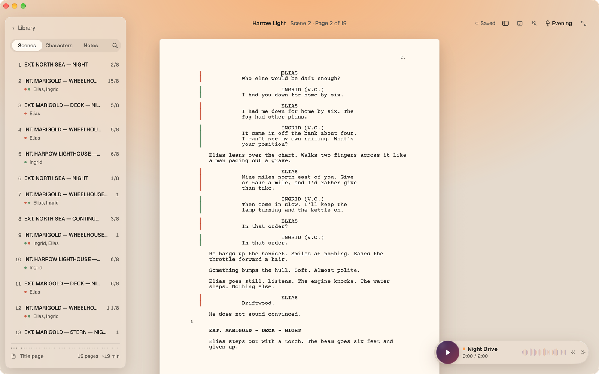
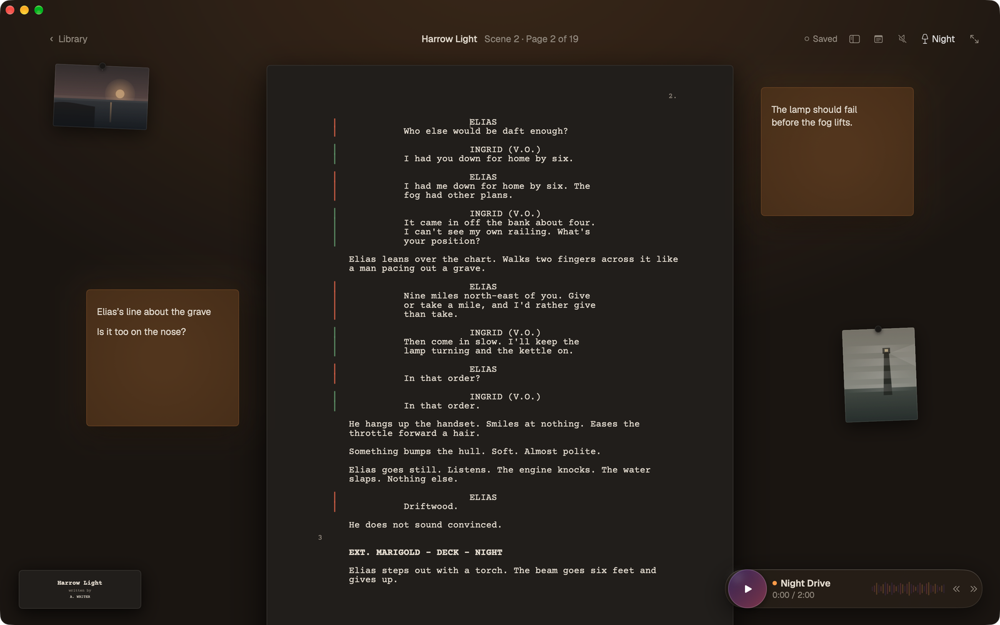
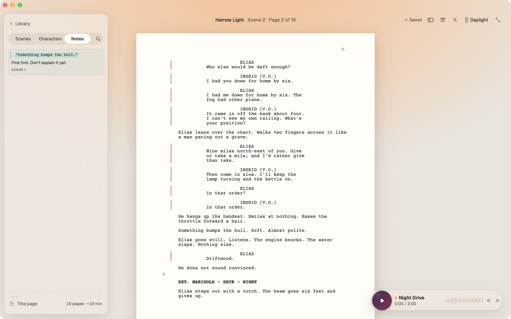
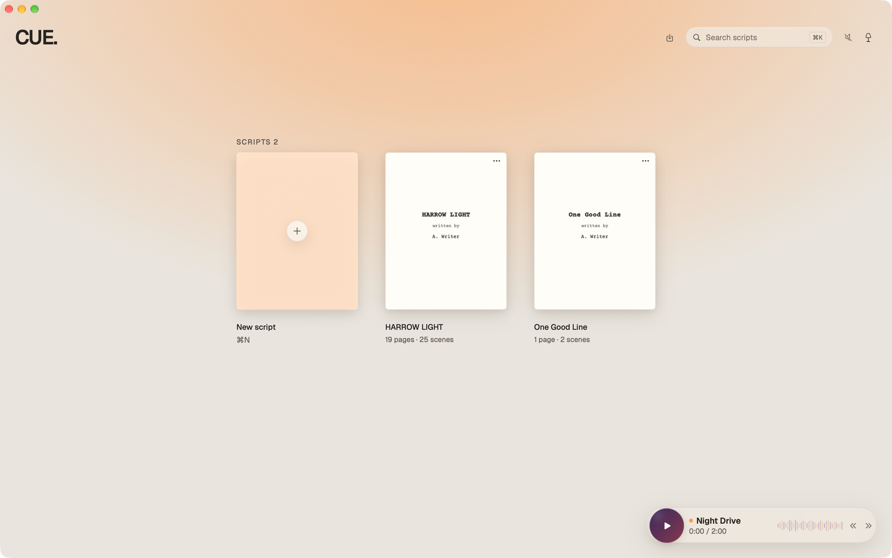
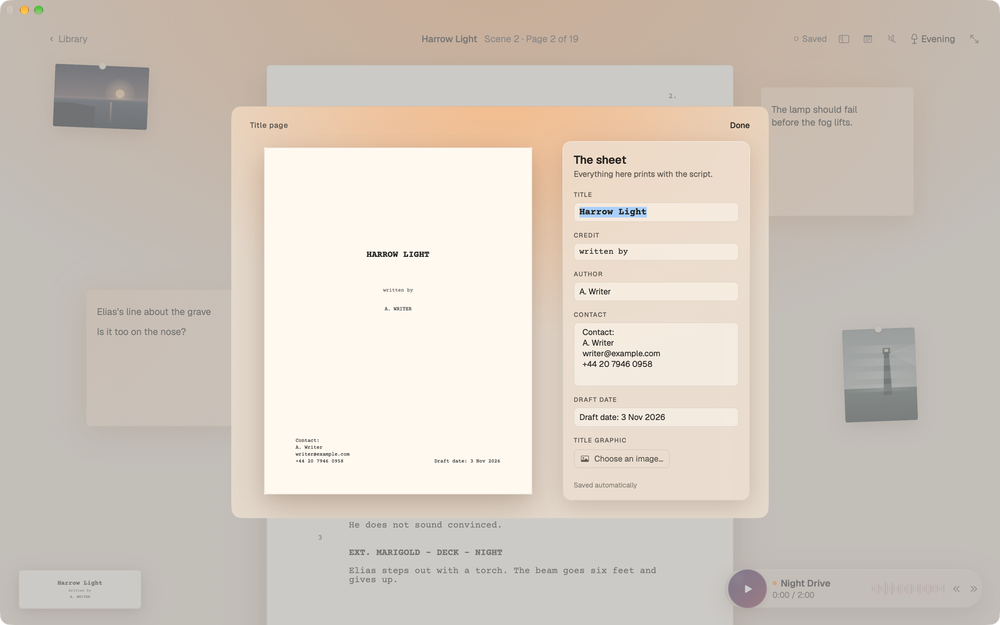
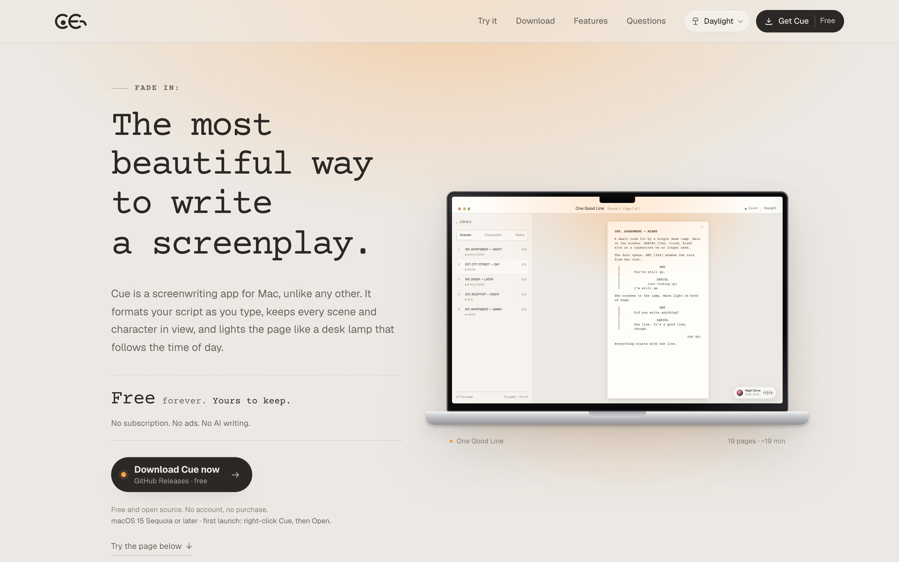

# Cue

**The most beautiful way to write a screenplay.**

Cue is a native screenwriting app for Mac. It formats the page as you type, keeps every scene and character a glance away, and lights the desk like a lamp that follows the time of day. Everything is written in Swift and SwiftUI, with a hand-built TextKit editor — no web views, no subscriptions, and no AI writing. Cue is free: download the latest build from [GitHub Releases](https://github.com/Abhinav-Prabhakar/CueScreenWriter/releases/latest).

<p align="center">
  
</p>

<p align="center">
  <a href="https://github.com/Abhinav-Prabhakar/CueScreenWriter/releases/latest"></a>
  <a href="https://abhinav-prabhakar.github.io/CueScreenWriter/"></a>
  
  
  
  
  
</p>

---

## What it is

A complete writing room in one window:

- **A real screenplay engine.** Scene headings, action, characters, parentheticals, dialogue and transitions are inferred as you type. Tab cycles the element type; Return opens the next logical line; INT./EXT. and character names complete from the script itself.
- **The desk, not a dashboard.** A scene list with eighths and cast, a character roster in their own colours, and line notes that stay pinned to the page.
- **Loose paper.** Double-click the desk to drop a sticky note exactly where you clicked, then write in it in place — tint, cross out, delete and finish without ever opening a dialog. Pin photographs beside the page, and rename the script by double-clicking its title.
- **Three kinds of light.** Daylight, Evening and Night, plus Auto. The lamp can be dimmed, and the whole interface follows.
- **A sound library.** Fourteen synthesized rooms across Focus, Weather and Places — from *Night Drive* and *Tape Hiss* to *Distant Thunder*, *Café Murmur* and *Harbour Fog*. Rendered on the Mac as you use them, with a real transport, a volume control and no audio files or downloads.
- **Updates that stay out of the way.** Cue asks GitHub Releases once a month, downloads a newer build in the background and installs it the next time you quit. Check any time with `⌘U`, from the menu bar, or in Settings.
- **At home on the Mac.** A native Settings window, a menu bar extra, a full Touch Bar (transport, rooms, lamp, notes, sticky, title page, sidebar) and real AppKit context menus on the desk.
- **Your files, on your Mac.** Scripts live as a readable JSON manifest with their attachments in `~/Library/Application Support/Cue`. Import and export Fountain; import and export screenplay PDFs.

<p align="center">
  
  
</p>

<p align="center">
  
  
</p>

## The landing page

The marketing site is a fully static build in [`docs/`](docs/) — plain HTML, CSS and JavaScript, local fonts, no CDN, no build step. It includes the working screenplay demo, the lamp picker, the illustrated feature tour and the privacy/support pages.

**Live:** <https://abhinav-prabhakar.github.io/CueScreenWriter/>

[](https://abhinav-prabhakar.github.io/CueScreenWriter/)

## Build and run

**Requirements:** macOS 15 (Sequoia) or later, Xcode 16 or later. [XcodeGen](https://github.com/yonaskolb/XcodeGen) is optional; the generated project is committed.

```sh
git clone https://github.com/Abhinav-Prabhakar/CueScreenWriter.git
cd CueScreenWriter/Cue
open Cue.xcodeproj
```

Choose the **CueApp** scheme and run. To build from the command line:

```sh
cd Cue
xcodebuild -project Cue.xcodeproj \
  -scheme CueApp \
  -configuration Debug \
  -derivedDataPath .build \
  CODE_SIGNING_ALLOWED=NO build

open .build/Build/Products/Debug/Cue.app
```

To regenerate the Xcode project after adding files:

```sh
cd Cue
xcodegen generate
```

### Tests

The repository has 39 tests: 20 for the model, formatting rules and update versioning, and 19 for the document store, Fountain round trips, PDF import/export, the desk model, sticky placement and title renaming.

```sh
cd Cue

xcodebuild test -project Cue.xcodeproj -scheme CueKit \
  -configuration Debug -derivedDataPath .build CODE_SIGNING_ALLOWED=NO

xcodebuild test -project Cue.xcodeproj -scheme CueApp \
  -configuration Debug -derivedDataPath .build CODE_SIGNING_ALLOWED=NO
```

The app tests are hosted inside `Cue.app`, so they exercise the same bundle and resources as the shipping build.

## Keyboard

| Action | Shortcut |
| --- | --- |
| New script | `⌘N` |
| Library | `⇧⌘0` |
| Toggle sidebar | `⌥⌘\` |
| Add a note on the current line | `⇧⌘N` |
| Save now | `⌘S` |
| Add a sticky note | `⇧⌘T` |
| Sound library | `⇧⌘M` |
| Check for updates | `⌘U` |
| Import a script | `⌘O` |
| Export PDF | `⇧⌘E` |
| Export Fountain | `⌥⌘E` |
| Daylight / Evening / Night / Auto | `⌥⌘1` / `⌥⌘2` / `⌥⌘3` / `⌥⌘0` |
| Lamp on or off | `⌥⌘L` |
| Help and shortcuts | `⌘/` |

Inside the editor, `Tab` cycles the current element through its valid next types, and `Return` moves to the next element — dialogue after a character, action after a scene heading. Suggestions in the margin accept with `Tab`.

## How it is put together

```
Cue/
├── CueKit/           design tokens, palettes, script model, formatter, ghost rules, analysis
├── CueApp/           the Mac app
│   ├── Editor/       TextKit editor, page furniture, selection and note anchoring
│   ├── Views/        library, writing screen, sidebar, desk objects, sheets
│   ├── Document/     Fountain, PDF import/export, the library store
│   ├── Audio/        fourteen synthesized rooms and the transport
│   ├── Update/       GitHub release checks, staging and the install helper
│   ├── TouchBar/     the window's Touch Bar
│   └── AppModel.swift
├── CueSite/          a native SwiftUI rendering of the marketing page
├── CueShared/        bundled fonts and app screenshots
└── Tests/            CueKitTests and CueAppTests
```

- **`CueKit`** is pure model and design language. The screenplay engine is testable on its own: `Formatter`, `GhostRules`, `ScriptAnalysis`, `PageMetrics` and the lamp/type/colour tokens all live here.
- **`CueApp`** draws the window. The editor is an `NSTextView` subclass inside a SwiftUI page; the chrome — toolbar, glass sidebar, desk objects, sheets — never scrolls with the script.
- **`LibraryStore`** writes a JSON manifest with ISO 8601 millisecond dates and attachments beside it. Writes are atomic; a corrupt manifest is quarantined rather than deleted. Set `CUE_DATA_DIR` to run against a throwaway store.
- **The static site** is independent of the app build. It lives in `docs/` and is published by GitHub Pages from `main`; `.nojekyll` keeps the asset folders intact.

## Design notes

The interface is built from a small set of deliberate materials: warm paper with a 6 pt radius and two shadows, translucent glass with a hairline edge, and a radial lamp pool drawn as a scaled ellipse. Courier Prime sets the script; Geist sets the interface. Every palette is defined three times — Daylight, Evening, Night — including the character colours and the toolbar ink, so nothing falls back to a default system grey when the lamp changes.

The page geometry follows standard US Letter proportions (8.5 × 11 in), with the 1-inch margins and 12 pt Courier baseline that screenplays expect. Scene numbers, page numbers and character margin marks are drawn by the editor rather than embedded in the text, so the document stays clean when it is exported.

## Data and privacy

Cue does not have an account, analytics or an update service of its own. Scripts, notes and images never leave the Mac unless you export them. The one network request is the monthly (or manual) check for a newer release on GitHub; the download comes straight from the repository. The sound library is generated in-process. The marketing site is static and stores only the lamp choice in `localStorage`.

## License and credits

The source in this repository is available under the [MIT License](LICENSE). Cue is an independent project and is not affiliated with or endorsed by cuescreenwriter.com.

Courier Prime and Geist are bundled under the SIL Open Font License 1.1; see [THIRD_PARTY_NOTICES.md](THIRD_PARTY_NOTICES.md).

<p align="center"><sub>FADE OUT.</sub></p>
